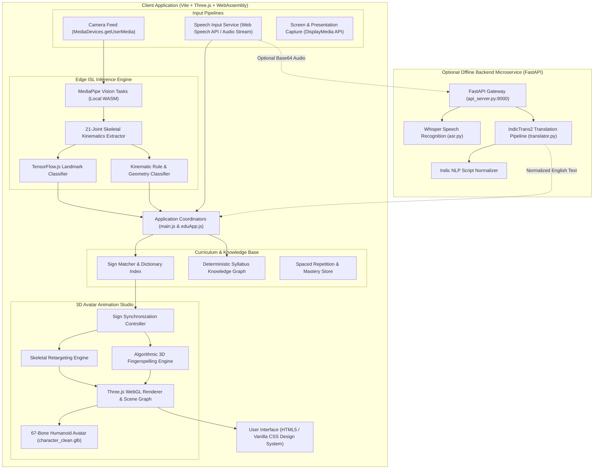
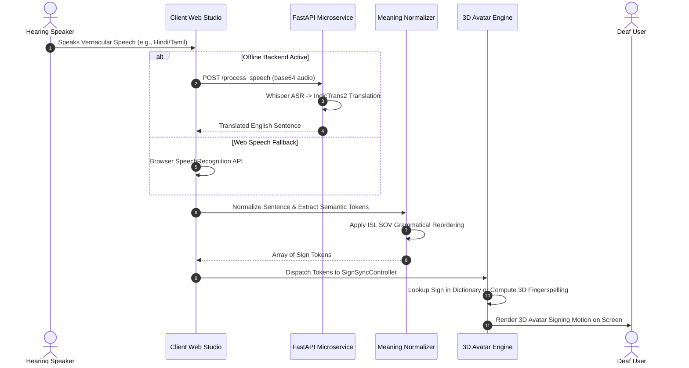
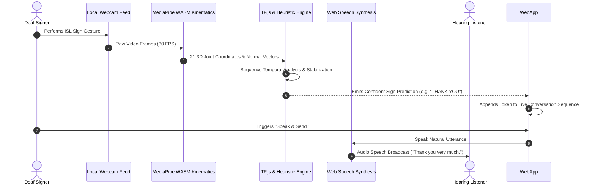

# Voice2Sense — Technical Design Document

## 1. System Overview

**Voice2Sense** (incorporating **SignBridge 3D**) is an assistive communication and educational technology platform designed to bridge the interaction barrier between Deaf/Hard-of-Hearing (DHH) individuals and hearing peers, educators, and service providers across India.

The system combines:
1. **Bidirectional Two-Way Communication Hub**: Seamlessly translates spoken vernacular audio into Indian Sign Language (ISL) 3D avatar animations, and classifies incoming webcam hand gestures into text and natural synthesized speech.
2. **Adaptive ISL Educational Studio**: A curriculum-aligned learning portal integrating spaced repetition, interactive kinematic checks, and deterministic syllabus exploration.
3. **Privacy-Preserving Edge Architecture**: Performs continuous 21-joint skeletal landmark extraction and sign classification client-side via WebAssembly and WebGL/WebGPU, ensuring camera feeds never leave the user's device.

---

## 2. High-Level Architecture Diagram

---

## 3. Component Responsibilities

### 3.1 Client-Side Application (`viewer/`)
* **Coordinator Layer (`main.js` & `eduApp.js`)**: Orchestrates user interactions, manages tab transitions between Real-Time Communication and Educational portals, and binds event streams.
* **Two-Way Communication Hub (`main.js`)**: Houses split studio views for Deaf and Hearing participants, live conversation timelines, and automatic speech-to-gesture and gesture-to-speech dispatchers.
* **3D Avatar Engine (`character_clean.glb`, `retarget.js`, `fingerspell.js`)**:
  * Loads a 67-bone articulated humanoid mesh.
  * Dynamically computes joint rotation quaternions for fingerspelling letters A–Z and digits 0–9 in real time.
  * Synchronizes subtitle queues and avatar handshapes with speech audio rates.
* **Kinematic Vision Pipeline (`islRecognitionService.js`)**:
  * Consumes raw video frames at 30 FPS.
  * Executes Google MediaPipe Hand Landmarker via SIMD/non-SIMD WebAssembly.
  * Calculates authentic 3D palm normal vectors, finger curl ratios, inter-digital angles, and temporal trajectories.
  * Classifies 40 verified ISL signs using combined deep learning (TF.js) and geometric heuristics.
* **Syllabus Knowledge Graph (`academicAIService.js`)**:
  * A 100% offline, deterministic educational graph providing grade-appropriate explanations, real-world examples, and key concept mappings for Secondary science, math, and digital literacy.

### 3.2 Offline Backend Microservice (`multilingual translation/`)
* **Gateway (`api_server.py`)**: Exposes asynchronous REST endpoints (`/translate`, `/process_speech`, `/asr`) with CORS headers.
* **Speech-to-Text (`asr.py`)**: Loads OpenAI Whisper (`whisper-tiny`) to convert incoming microphone audio into vernacular text.
* **Multilingual Translation (`translator.py`)**: Leverages AI4Bharat's `IndicTrans2` model to translate 22 scheduled Indian languages into standardized English text suitable for ISL syntax mapping.
* **Script Normalization (`indicnlp/`)**: Provides Brahmi-derived script normalization, tokenization, and transliteration.

---

## 4. End-to-End Data Flow

### 4.1 Hearing-to-Deaf Pipeline (Voice -> Indian Sign Language)

### 4.2 Deaf-to-Hearing Pipeline (ISL Gesture -> Voice Speech)

---

## 5. Security, Privacy, & Data Governance

1. **Zero Cloud Camera Transmission**: All computer vision algorithms run directly inside the user's browser using client-side WebAssembly (`viewer/public/wasm/`). Video frames are analyzed in transient canvas buffers and immediately discarded; zero frames are uploaded to external servers.
2. **Local Machine Isolation**: The multilingual translation microservice binds strictly to loopback (`127.0.0.1:8000`). No inbound public networking is required.
3. **Stateless Processing**: Speech audio sent to the local backend is processed in-memory and is not written to persistent disk storage.
4. **Secret Hygiene**: Zero API keys or cloud credentials exist in the codebase. All endpoints rely on open models and local services.

---

## 6. Current Technical Limitations & Future Roadmap

* **Sentence Animation Fallback**: Because the full 100+ GB raw motion capture dataset (`Train/`) is excluded for repository portability, sentence replay defaults to word-by-word 3D fingerspelling.
  * *Future Roadmap*: Compress representative motion capture clips into optimized binary WebAssembly motion streams (<500 KB each).
* **Initial CDN Requirement**: First-time web page launch loads TensorFlow.js from CDN before client caching takes over.
  * *Future Roadmap*: Vendor `tf.min.js` directly into `viewer/public/js/` for 100% air-gapped out-of-the-box initialization.
* **Two-Hand Facial Kinematics**: Current gesture detection focuses primarily on hand landmarks.
  * *Future Roadmap*: Integrate MediaPipe Holistic to track non-manual facial expressions and torso orientation essential for advanced ISL grammar.
